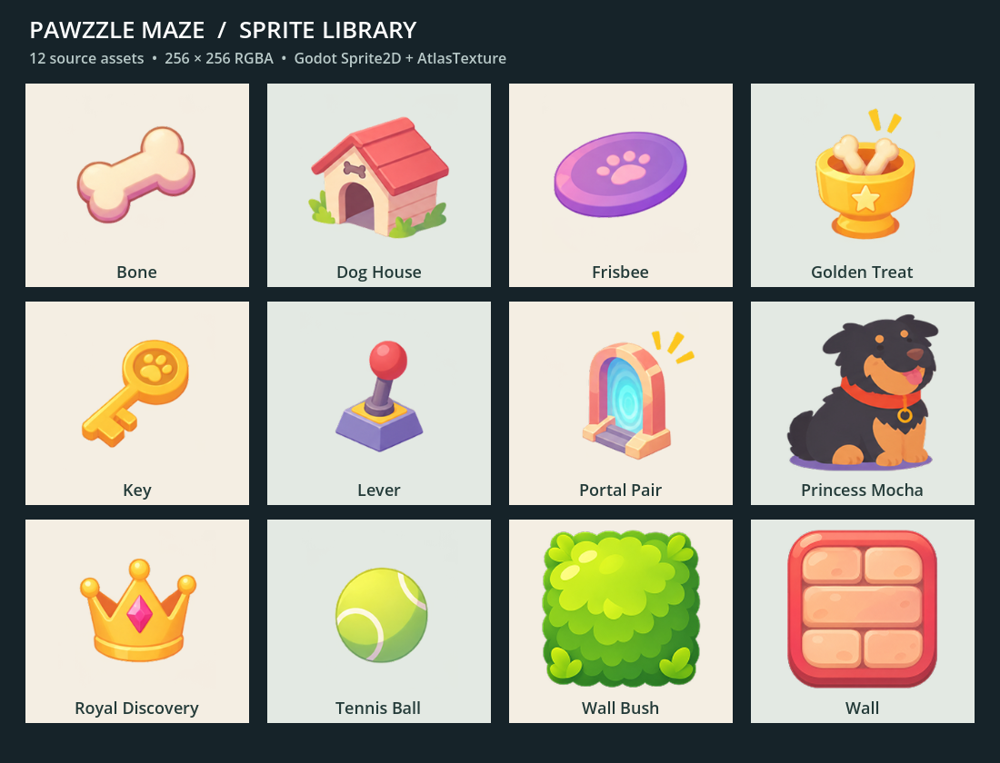

# Pawzzle Maze sprites

Twelve static sprites derived from the PNGs in [../Assets](../Assets), built and checked in Godot 4.7.2 through Godlink MCP 0.6.1.

## Contents

- `textures/`: twelve individual 256 × 256 RGBA PNGs.
- `sprite_atlas.png`: the same sprites in a 1024 × 768 atlas (4 columns × 3 rows).
- `atlas/`: twelve Godot AtlasTexture resources with clipping enabled.
- `scenes/`: twelve reusable Node2D scenes, each containing a centered Sprite2D with linear texture filtering.
- `Preview.tscn`: labeled gallery, designed for an 1100 × 840 viewport.
- `manifest.json`: source filenames and SHA-256 hashes, crop rectangles, content bounds, pivots, atlas regions, and resource paths.
- `GenerateSprites.tscn` / `generate_sprites.gd`: reproducible Godot image-processing utility.
- `ValidateSprites.tscn` / `validate_sprites.gd`: resource and atlas checks.

## Use in the existing Godot project

The repository's Godot project lives in `games/godot`; this root-level folder is a portable asset pack. Copy the whole `Sprites` folder into `games/godot/Sprites` (or any Godot 4 project root), keeping its name so resources resolve at `res://Sprites/`. Let Godot import the images.

Open `res://Sprites/Preview.tscn` and press F6 to view the gallery. Drag any scene from `res://Sprites/scenes/` into a game scene. Default size is 256 × 256; set the root scale to `Vector2(0.25, 0.25)` for a 64 × 64 sprite footprint. The pivot is at the canvas center (128, 128). PNGs can also be used independently in other engines.

These are visual resources: gameplay collision, interaction behavior, and animation are not attached. All 12 supplied images are static; no additional poses were invented. `portal_pair` uses the single portal illustration supplied under that filename; instance it twice when a pair is needed. Walls are individual sprites, not a seamless autotile set.

## Processing

Godot loads each original PNG, converts to RGBA8, crops only fully transparent outer margins, preserves aspect ratio, and resizes with Lanczos filtering to fit within 224 × 224 pixels. It centers the result on a transparent 256 × 256 canvas, giving at least 16 pixels of padding on every side. Source colors, semitransparent edges, and artwork are preserved. The atlas uses these exact PNG pixels without overlap.

## Regenerate and validate

1. Copy the original 12 PNGs into `res://sprite_sources/`, or set the GenerateSprites root node's `source_directory` to their local directory.
2. Run `GenerateSprites.tscn` with F6 in the editor. It replaces the generated textures, atlas, and manifest; existing resource/scene names remain valid.
3. Allow the editor to reimport the modified PNGs.
4. Run `ValidateSprites.tscn` with F6. Success prints `SPRITES_VALIDATED`.
5. Run `Preview.tscn` for visual inspection.

The generator is a local editor utility that writes project files; do not run it in an exported game. The sprite scenes themselves use standard imported Texture2D/AtlasTexture resources and do not require the MCP plugin.

## Validation performed

Godot 4.7.2 successfully loaded all 12 sprite scenes and all textures, checked alpha and transparent corners, and compared each atlas region byte-for-byte with its individual PNG. Generator, validation scene, and gallery ran with zero reported errors or warnings after the final changes. The gallery screenshot above was captured from the running Godot viewport.
