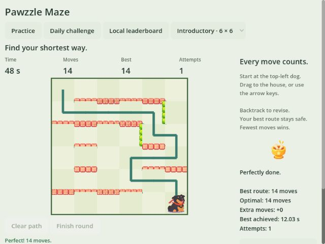
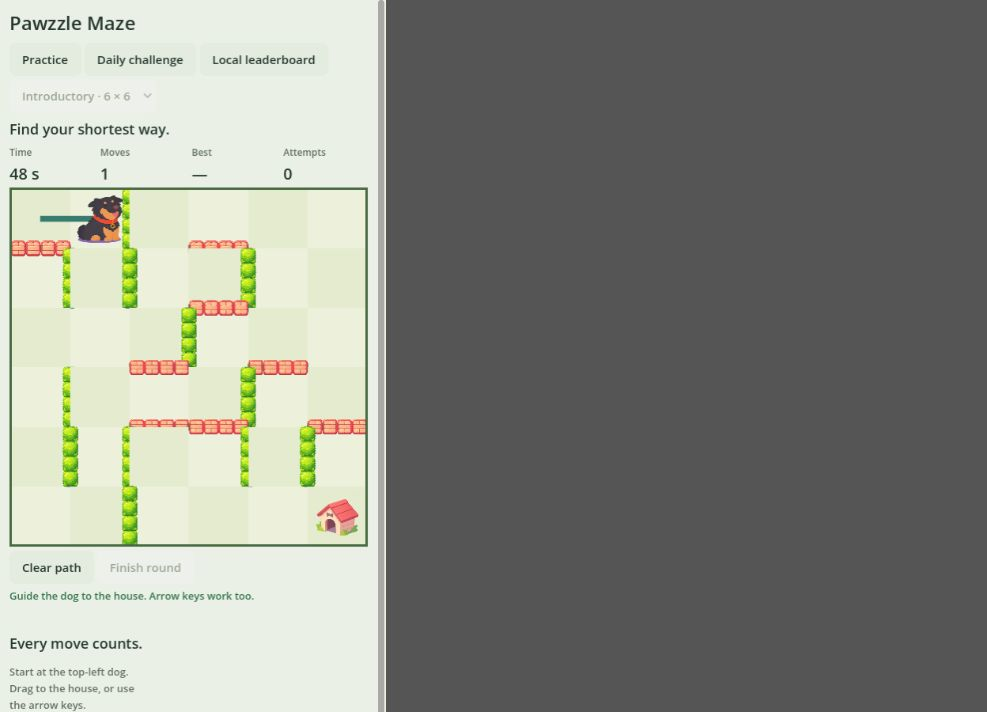

# Godot GamePix web verification — 7 November 2026

## Scope

Sprite integration and GamePix export for the existing Godot timed shortest-route game. This is not the V3 princess-delivery campaign in `apps/web`. No gameplay rules were ported from V3 in this change.

## Verified

| Check | Evidence |
| --- | --- |
| Rules | 8,438 assertions passed across deterministic generation, connectivity, routes and deadlines. |
| Complete round | Godot integration test completed an optimal route and verified score, results and editing lockout. |
| Pause and audio | Integration test verified overlapping SDK/visibility reasons, rejected movement while paused, preserved deadline/elapsed time, idempotent pause, and restoration of the prior mute setting. |
| SDK bridge | Eight Node tests passed: SDK load order, manual lifecycle, visibility/SDK overlap, early pause, failed ads, reward success, concurrent ad rejection and storage failure. |
| Release export | Godot 4.7.2, Compatibility renderer, WebGL 2, single-threaded Web preset. |
| 640 × 480 iframe | Loaded, started and completed two mazes with keyboard input (18- and 14-move optimal routes); trophy and result text appeared. Final board size remains stable when results appear. Scroll exposes review/replay controls. |
| Portrait iframe | 390 × 844 layout fits horizontally; started a game and dragged the dog to an adjacent cell, incrementing the move count. |
| Replay | Browser replay returned to the start screen and reset the round. |
| Fresh browser startup | No console errors or warnings in a fresh tab after the final shell changes. An intermittent MutationObserver error was seen during earlier iframe navigation; it did not reproduce in the fresh load. |
| Packaging | ZIP contains index.html and matching JS/WASM/PCK at root; exported files use relative paths. Development MCP and sprite generator/test scenes are excluded. |

## Remaining platform checks

- This is local browser verification, not a GamePix acceptance result. Upload the ZIP to the GamePix test player before publication.
- Actual hosted ads, SDK-synchronized cross-session storage and publisher-specific hosting must be checked on GamePix. Ad outcomes were tested with SDK mocks; the game currently requests no ads automatically.
- Physical iOS/Android touch, mobile audio interruption and Safari have not been tested.
- The listing must describe this timed maze game, or the V3 campaign must be ported before using the existing princess-delivery listing.

## Reproduce

See [Godot README](../games/godot/README.md), [build script](../tools/build-gamepix.ps1), and [official plugin changes](../games/godot/addons/gpx-godot-plugin/PAWZZLE_CHANGES.md).
