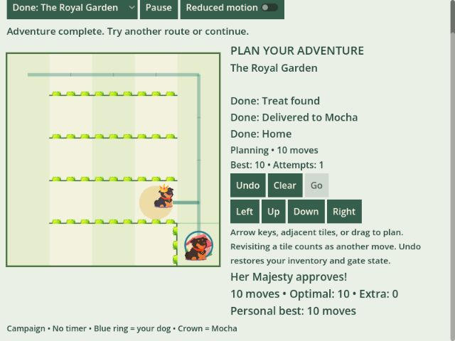
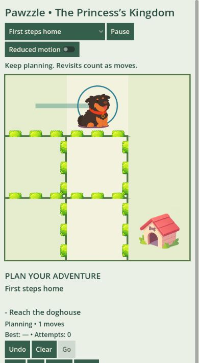

# Godot V3 GamePix web verification — 7 November 2026

## Scope

The Godot entry point now ports the current three-level V3 campaign using the supplied sprite atlas. The release ZIP contains this campaign, replacing the former timed-maze entry point. Optional timed/ranked modes, future mechanics and additional chapters are not part of the opening campaign.

## Verified

| Check | Evidence |
| --- | --- |
| JavaScript reference | 19 V3 rules/campaign tests passed. |
| Godot parity | 393 assertions passed, covering all 352 reachable directional transitions across three levels, exact state/events, every optimal playback frame and independent full-state BFS optima of 4, 6 and 10 moves. |
| Campaign integration | 63 assertions passed: locks/unlocks, invalid submission, missing-treat gate, delivery, Undo/Clear inventory restoration, duplicate Go, complete playback/results, retained bests, JSON save restoration and rejection of incomplete/version-mismatched saves. |
| Pause/audio | Integration verifies frozen input/playback, overlapping pause reasons and restoration of prior mute state. Browser manual Pause held the dog at the starting frame, then Resume finished the route. |
| SDK bridge | Eight tests passed for lifecycle/load order, pause overlap, early pause, failed ads, successful rewards, concurrent ads and storage failure. |
| 640 × 480 iframe | Completed all three levels using keyboard planning and Go; verified 4-, 6- and 10-move optimal results, tutorial unlocks, blocked royal gate and delivery objectives. Results are reachable by vertical scrolling. |
| Portrait iframe | 390 × 844 layout fits horizontally; dragging to an adjacent tile incremented the plan by one move. |
| Standalone reload | Completed the first lesson, reloaded index.html, and verified the completed marker and 4-move best remained with a fresh plan. No console warnings/errors in the standalone test tab. |
| Local iframe limitations | Reloading the bare iframe harness did not restore its saved progress. It has no GamePix Player to service SDK synchronization. Two MutationObserver errors appeared around iframe initialization/navigation, without blocking play; they did not occur in the standalone test. Hosted iframe persistence must be verified in the actual GamePix Player. |
| Release export | Godot 4.7.2, single-threaded Compatibility/WebGL 2 preset; no backend or isolation headers required. Tests and sprite-generation tooling excluded from the export. |

## Reproduce

See [Godot README](../games/godot/README.md), [test runner](../tools/test-godot-campaign.ps1), and [export script](../tools/build-gamepix.ps1). The build checks generated campaign data against the canonical JavaScript catalog before exporting.

The browser test served the exported index.html/JS/WASM/PCK files that are packaged at ZIP root in `releases/pawzzle-maze-gamepix.zip`.

## Remaining platform checks

This is local verification, not GamePix acceptance. Upload the ZIP to the GamePix test player to verify processing, hosted storage and actual ad behavior before publication. Physical iOS/Android touch, Safari and mobile audio interruptions remain untested. The game requests no ads automatically. Final listing icon/cover preparation is separate.

The storage integration follows the [official SDK storage guidance](https://partners.gamepix.com/sdk/doc/javascript): load the SDK first, use localStorage methods with known keys, and verify synchronization in the GamePix Player.
